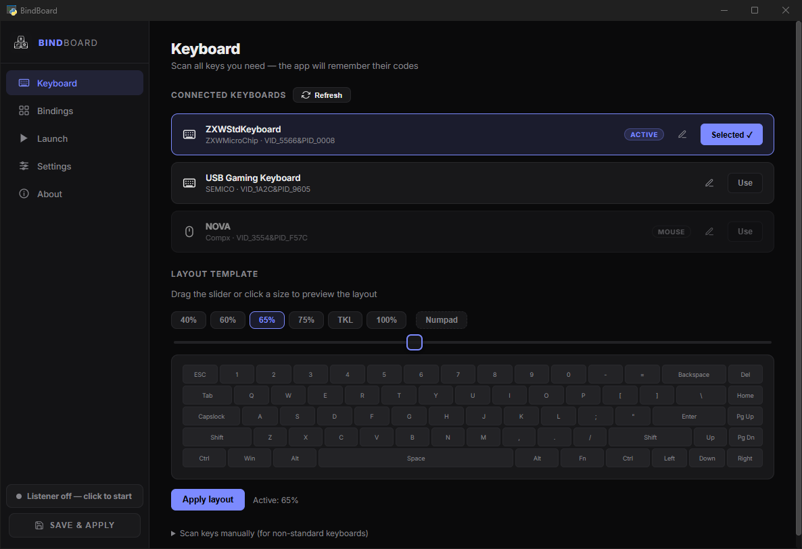
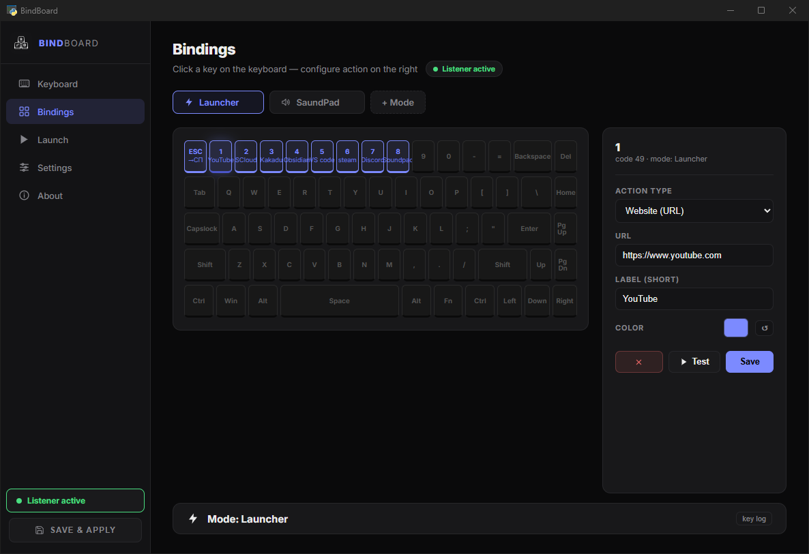
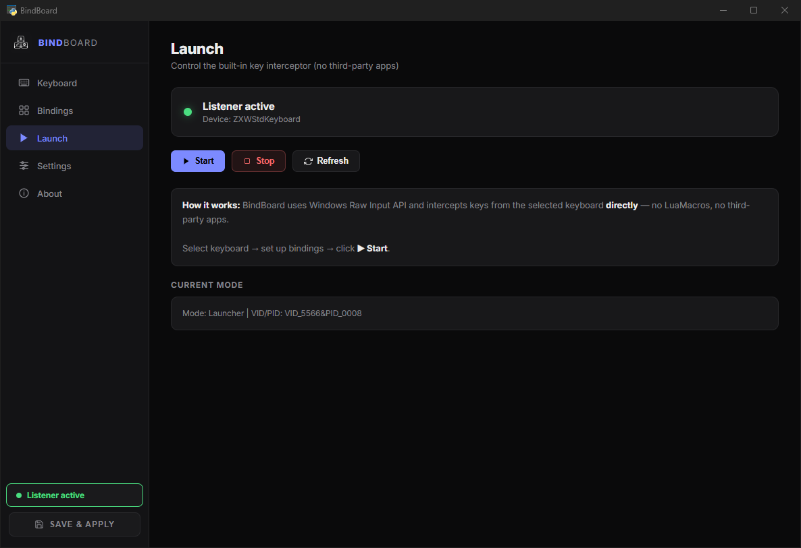
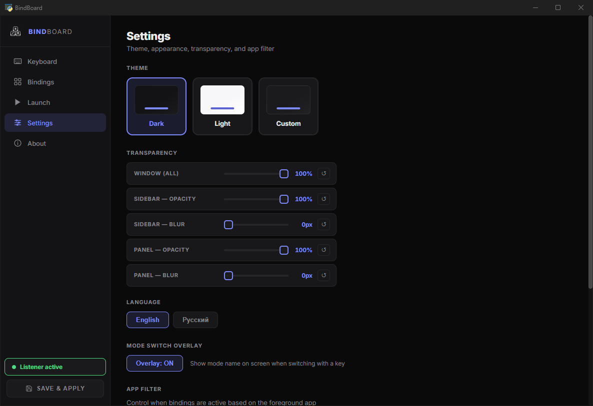

# BindBoard

**BindBoard** is a macro keyboard app for Windows. Assign actions to keys on a second keyboard — your main keyboard keeps working as normal.  
Built on Windows Raw Input API — no drivers, no third-party software required.


[](https://www.reddit.com/user/No_Echo_2124)

---

## Screenshots

| Keyboard setup | Bindings |
|---|---|
|  |  |

| Launch | Settings |
|---|---|
|  |  |

---

## Features

- 🎹 **Per-device key interception** — keys from the second keyboard trigger actions; your main keyboard is untouched
- 🔌 **Any USB or Bluetooth keyboard** — devices are listed by their real names, and two keyboards of the same model can be selected separately
- ➕ **Custom layouts** — scan extra keys (arrows, macro keys, F13–F24…) and add them to any template
- 🗂 **Modes** — create multiple binding profiles and switch between them with a single key press
- 🖥 **Mode overlay** — a brief on-screen hint appears whenever you switch modes
- 🚀 **Action types** — open a URL, launch a program or shortcut, start a Steam game, play a sound via Soundpad, or switch mode
- 🔍 **App & game picker** — browse installed programs and Steam games by name, no manual path or ID entry needed
- 🌐 **English & Russian UI** — language is detected automatically from your system locale
- 🔔 **System tray** — closing the window minimizes to tray; the listener keeps running in the background
- 🪶 **Light on resources** — no keyboard hook: other keyboards' keys pass through Windows untouched, and the app idles at ~0% CPU in the tray

---

## Installation

### Ready-to-run EXE (recommended)

1. Go to [Releases](../../releases)
2. Download `BindBoard.zip`
3. Extract to any folder
4. Run `BindBoard.exe`

> Requires Windows 10/11 with [WebView2 Runtime](https://developer.microsoft.com/en-us/microsoft-edge/webview2/) (already included in Windows 11)

### From source

**Requirements:** Python 3.10+, Windows 10/11

```bash
git clone https://github.com/Mark-mark-228/BindBoard.git
cd BindBoard
pip install -r requirements.txt
python app.py
```

---

## Quick start

1. Launch **BindBoard**
2. Go to **Keyboard** → click **Refresh** → select your second keyboard → click **Apply layout**
3. Go to **Bindings** → click any key → choose an action on the right → click **Save**
4. Go to **Launch** → click **Start**

Your keys are live!

---

## Modes

Modes let you have multiple sets of bindings on the same physical keys — for example one profile for music control and another for gaming.

- Click **+ Mode** to create a new profile
- Assign any key the **"Switch mode"** action to jump between profiles
- A brief overlay appears on screen whenever the mode changes

---

## Command-line options

| Option | What it does |
|---|---|
| `--minimized` | Start hidden in the tray (useful for a startup shortcut) |
| `--selftest` | Load the UI hidden, check the JS ↔ Python bridge, write `selftest.json` to the config folder and exit (code 0 = OK) |

Settings live in `%USERPROFILE%\BindBoard\` (`config.json`, `backups\`, `bindboard.log`). Set `BINDBOARD_HOME` to use another folder.

---

## Building the EXE

```powershell
.\build.ps1
```

`build.ps1` installs the requirements, builds with `BindBoard.spec`, runs the new EXE with `--selftest`, then packs the installer (or a ZIP). The build is at `dist\BindBoard\`.

---

## Tests

```bash
python -m unittest discover -s tests -v
```

The suite covers config saving/backups, the app filter, key normalisation, the listener and modes, actions, the Soundpad pipe client, icons, and real Raw Input via `SendInput` (set `BINDBOARD_SKIP_INPUT_TESTS=1` to skip the tests that inject F23/F24 presses and a Shift tap). `tests/check_frontend.mjs` statically checks `app.html` (needs Node.js).

---

## Project structure

```
BindBoard/
├── app.py           — backend: Raw Input, bindings engine, tray, API
├── app.html         — frontend: single-page app (HTML / CSS / JS)
├── tests/           — unittest suite + frontend static checks
├── bindboard.ico    — app icon
├── BindBoard.spec   — PyInstaller build config
├── requirements.txt — Python dependencies
├── screenshots/     — README screenshots
└── assets/          — UI icons and resources
```

---

## Dependencies

| Package | Purpose |
|---|---|
| `pywebview` | App window (Chromium WebView2) |
| `pystray` | System tray icon |
| `Pillow` | Icon processing |
| `pyinstaller` | EXE build (dev only) |

---

## Community

Every update is announced on Reddit: [u/No_Echo_2124](https://www.reddit.com/user/No_Echo_2124). Ideas and bug reports are welcome there or in [Issues](https://github.com/Mark-mark-228/BindBoard/issues).

---

## License

MIT — free to use, modify, and distribute.
